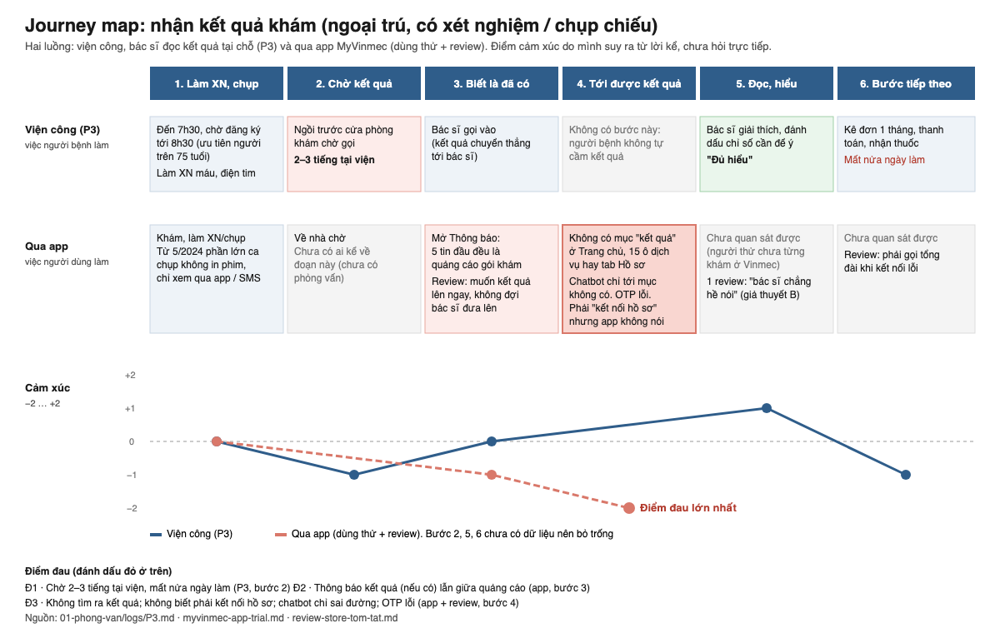

# Journey map: nhận kết quả khám

File nguồn: `journey-map.svg` (sửa trực tiếp bằng trình soạn thảo, mở bằng trình duyệt).

## Đọc sơ đồ

- **Hai luồng.** Hàng trên là luồng viện công P3 kể: kết quả đi thẳng tới bác sĩ. Hàng dưới là luồng qua app, ghép từ buổi tự dùng thử MyVinmec và review trên store.
- **Ô xám** là bước chưa có dữ liệu. Mình để trống thay vì đoán.
- **Điểm cảm xúc** do mình suy ra từ lời kể và thao tác, vì phiếu P3 không ghi từ ngữ cảm xúc. Lý do từng điểm nằm trong `01-phong-van/logs/P3.md`, mục "Cảm xúc theo bước".

## Điểm đau

| Mã | Bước | Điểm đau | Nguồn |
|---|---|---|---|
| Đ1 | 2. Chờ kết quả | Chờ 2–3 tiếng tại viện, mất nửa ngày làm | P3 |
| Đ2 | 3. Biết là đã có | 5 thông báo đầu đều là quảng cáo; thông báo kết quả (nếu có) sẽ bị lẫn | Dùng thử T5, review |
| **Đ3** | **4. Tới được kết quả** | Không có mục nào ghi "kết quả"; không biết phải kết nối hồ sơ; chatbot chỉ tới mục không có; OTP lỗi; chọn nhầm "tạo hồ sơ mới" thì mất lối kết nối | Dùng thử T3, T6; 5/21 review |

**Đ3 là điểm đau được chọn để giải**, vì ba nguồn cùng chỉ về nó (xem `01-phong-van/tong-hop-insight.md`, I1–I4). Đ1 có thật nhưng nằm ở vận hành tại viện, ngoài app.

Sơ đồ do AI (Claude) vẽ từ dữ liệu trong `01-phong-van/`; mình kiểm từng ô với log.
